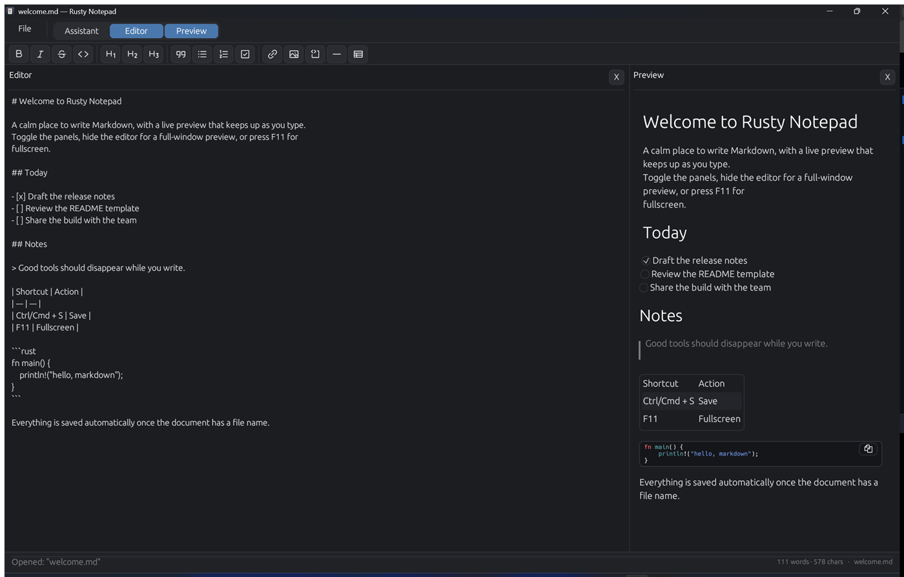

# Rusty Notepad

A fast, lightweight Markdown editor for Windows, macOS and Linux. Write on the
left, see the formatted document on the right, and optionally ask Gemini to
rewrite or extend it.



## Features

- **Live Markdown preview** that updates as you type.
- **Full-window preview** — hide the editor, or press `F11` for real fullscreen
  (`Esc` leaves it).
- **Formatting toolbar** for headings, lists, quotes, tables, links, images,
  code blocks, and more.
- **Settings menu** for editor and preview fonts, text sizes, and line spacing.
- **Starter templates** in the empty preview: README, meeting notes, blog post,
  changelog, task list, and project brief.
- **Autosave** once the document has a file name.
- **`rmd` command** to open or create notes from any terminal.
- **Optional AI assistant** that can rewrite or extend the document, with a
  choice of Gemini, OpenAI, Anthropic, OpenRouter, or DeepSeek.
- **Offline dictation** — press the microphone and a local Whisper model types
  into the document as you speak. Dropped audio files are transcribed too.
- **Native installers** for Windows, macOS (Apple Silicon and Intel), Debian/
  Ubuntu, and any Linux via AppImage.

## Install

Download the latest build from the
[releases page](https://github.com/fogelt/rust_notepad/releases).

| Platform | Artifact | Notes |
| --- | --- | --- |
| Windows | `*-setup.exe` | Current-user install, no admin. Adds `rmd` to `PATH` and registers `.md` / `.markdown`. |
| macOS | `.dmg` | Drag **Rusty Notepad** to Applications. |
| Debian/Ubuntu | `.deb` | Installs `rust_notepad` and `rmd` under `/usr/bin`. |
| Any Linux | `.AppImage` | Make it executable and run it. |

### Windows

Run the setup executable. Windows SmartScreen may warn because the installer is
unsigned; choose **More info → Run anyway**.

### macOS

Open the `.dmg` and drag the app to Applications. The build is ad-hoc signed
but not notarized, so Gatekeeper may block the first launch: on older macOS
versions use **right-click → Open**; on macOS Sequoia and later use
**System Settings → Privacy & Security → Open Anyway**. macOS asks for
microphone access the first time you dictate with the microphone.

### Linux

```bash
# Debian / Ubuntu
sudo apt install ./rust_notepad_*.deb

# AppImage
chmod +x rust_notepad_*.AppImage
./rust_notepad_*.AppImage
```

If your system cannot run AppImages directly, use
`./rust_notepad_*.AppImage --appimage-extract-and-run`.

## Using Rusty Notepad

- **File menu** — New, Open, Save, and Save As. Shortcuts: `Ctrl/Cmd+N`,
  `Ctrl/Cmd+O`, `Ctrl/Cmd+S`, `Ctrl/Cmd+Shift+S`.
- **Panels** — the Assistant, Editor, and Preview tabs toggle each panel. Hiding
  the editor gives the preview the full window.
- **Templates** — when the document is empty, the preview shows template buttons
  that fill the editor with a starting document.
- **Fullscreen** — `F11` toggles it; `Esc` exits.

## `rmd` command

`rmd` opens a note from the terminal, creating it if needed. If no name is
given, it prompts for one. Bare names get a `.md` extension.

```text
$ rmd
Name for the new note: ideas
Created /home/me/ideas.md
Opening /home/me/ideas.md in Rusty Notepad…

$ rmd todo.markdown
Opening /home/me/todo.markdown in Rusty Notepad…
```

On **Windows** and with the Linux **`.deb`**, `rmd` is installed on `PATH`
automatically. On **macOS**, link the helper from the app bundle once:

```bash
sudo ln -sf "/Applications/Rusty Notepad.app/Contents/MacOS/rmd" /usr/local/bin/rmd
```

For the **AppImage**, run the `install-rmd.sh` script included in the release:

```bash
sh install-rmd.sh ./rust_notepad_*.AppImage
```

It creates a `rmd` launcher in `~/.local/bin` (or `/usr/local/bin` when
writable). Use `rmd --help` for options.

## Assistant and dictation (optional)

The assistant works with Google Gemini, OpenAI, Anthropic, OpenRouter, or
DeepSeek.

1. Open **Settings → AI** in the top bar.
2. Pick the active provider and model, and add an API key for each provider you
   want to use (Gemini keys are available from
   [Google AI Studio](https://aistudio.google.com/api-keys)).
3. Type an instruction in the Assistant tab and press **Send** to rewrite or
   extend the document.

API keys are stored in the operating system's credential store (Windows
Credential Manager, macOS Keychain, or Secret Service on Linux), not in the
config file. Once a key is saved it is masked permanently: the app never shows
it again, only **Replace** or **Remove** actions. On Windows, uninstalling the
app also removes the saved keys and the downloaded dictation model.

**Dictation** starts with a **Provider / Local** toggle. Provider mode sends
audio to the active provider when it offers transcription — Google Gemini uses
the streaming Live model (`gemini-3.5-transcribe-live`), and OpenAI uses
`whisper-1`. Other providers don't expose an audio transcription API, so the app
asks you to choose Local instead. Provider mode needs an API key and the local
model table is disabled while it is active. Dropped audio files for Gemini use
the selected audio-capable chat model, since the Live model is stream-only.

Local mode runs entirely on your machine. Open **Settings → Dictation** and
download one of the models (stored in `%LOCALAPPDATA%\Rusty Notepad\models\`);
click an installed row to use it.

| Model | Download | RAM while dictating |
|---|---|---|
| Whisper Tiny | ~116 MB | ~0.5 GB |
| Whisper Base | ~208 MB | ~1 GB |
| Whisper Small | ~639 MB | ~2 GB |
| Whisper Medium | ~1.9 GB | ~4 GB |
| Whisper Large v3 | ~1.1 GB | ~5 GB |

All are multilingual and auto-detect the spoken language. RAM figures are
approximate; the download is a one-time cost. Medium and Large v3 are much
slower on CPU, so Tiny/Base/Small are usually the better trade-off.

Press the microphone in the editor toolbar to start and **Stop** to commit the
transcript. Transcription appears in roughly four-second chunks while you speak.
The editor locks while dictating, replacing any selection at the cursor.

You can also drop an audio file anywhere on the window; it is transcribed with
the same local model and streamed into the document. Supported formats include
`wav`, `mp3`, `m4a`, `aac`, `ogg`, and `flac`. Cancelled dictation rolls the
partial text back; if transcription fails, text already inserted is kept and a
toast explains what happened.

Visual reports may include up to two public-domain photos from Wikimedia Commons.
The app resolves the model's `commons:` image placeholders to real thumbnails,
adds a licence credit under each image, and downloads them in the background so
the preview stays responsive. Images load only when the report is viewed and
require an internet connection.

Reports are designed for the in-app preview: KPI cards, bars, timelines,
comparison tables, callouts, and pie or donut charts (drawn with CSS conic
gradients) all render without a browser engine. Layouts stay readable from a
320 px panel up to a wide window — multi-column card rows collapse to
full-width cards on narrow screens.

The active provider and model are stored locally in
`%APPDATA%\rust_notepad\config.json` on Windows and
`~/.config/rust_notepad/config.json` elsewhere.

## Development

Requires a recent stable Rust toolchain (1.87 or newer).

### Run and check

```bash
cargo run
cargo run -- <file.md>

cargo test
cargo fmt --all -- --check
cargo clippy --all-targets -- -D warnings
```

### Package

```bash
cargo build --release      # builds rust_notepad + rmd
cargo install cargo-packager --locked
cargo packager --release   # installer for the host OS
```

Pushing a `v*` tag (for example `v0.3.3`) runs
`.github/workflows/release.yml`, which builds Windows, macOS, and Linux
installers on native runners and attaches them to a GitHub release.

On Windows, local dictation uses the shared sherpa-onnx libraries, so
`target/release` also contains `onnxruntime.dll`,
`onnxruntime_providers_shared.dll`, `sherpa-onnx-c-api.dll`, and
`sherpa-onnx-cxx-api.dll`. Ship them next to `rust_notepad.exe`; the app will
not start without them. Linux and macOS link the static builds.

On Linux, the build needs `libasound2-dev` for microphone capture in addition to
the usual eframe dependencies (see `.github/workflows/ci.yml`). The `.deb`
depends on `libasound2` at runtime.

### Notes

- For local development, `GEMINI_API_KEY` and `GEMINI_MODEL` can be placed in a
  gitignored `.env` file.
- `vendor/egui_commonmark` is upstream 0.14.0 with small preview rendering
  patches (task-list bullets, configurable line spacing, code-copy UX, and
  spacing after code blocks). See its `PATCH.md` before updating the dependency.
- `src/app/audio.rs` captures and resamples microphone PCM and decodes dropped
  audio files; `src/app/local_stt.rs` runs the local Whisper model and downloads
  it on demand. `src/app/templates.rs` holds the starter documents, and
  `src/rmd_cli.rs` is shared by `rmd` and `rust_notepad --rmd`.
- `scripts/generate-icon.py` regenerates `assets/icon.png` and `icon.ico` with
  Python 3 + Pillow.
